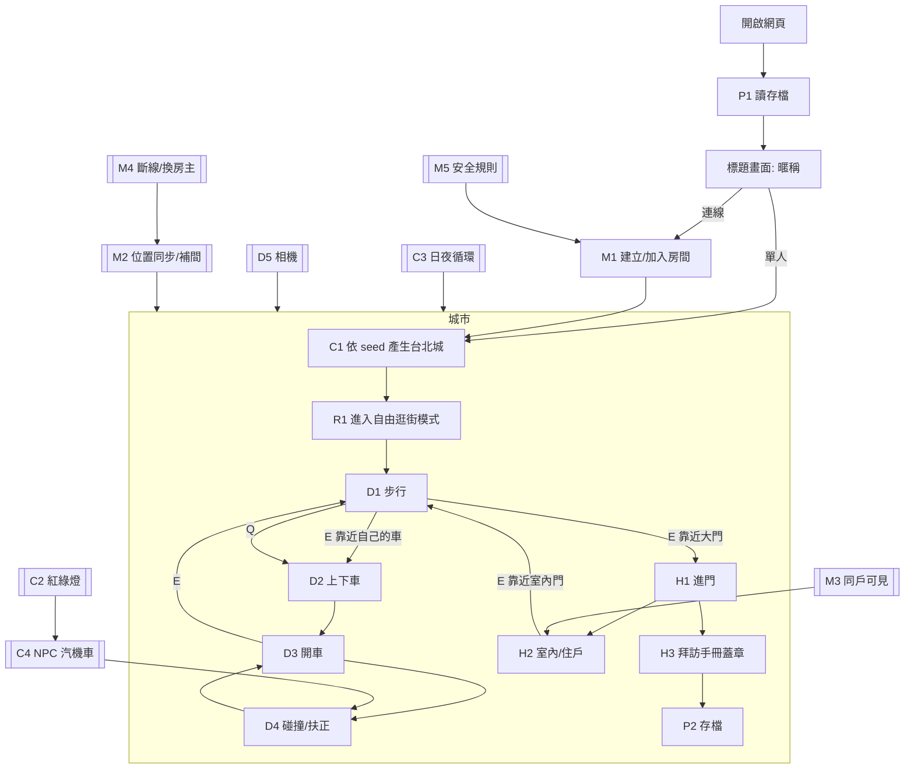
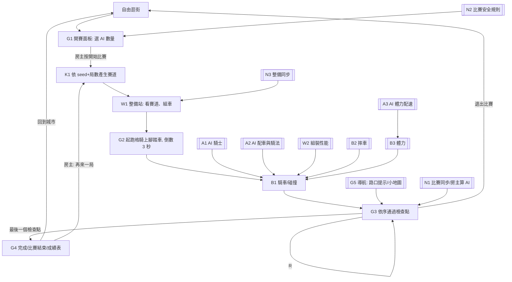

# 01 · Flow 與節點

開發照節點推進：一個節點 = 一組可驗收的行為。節點完成的定義是「驗收條件全部有對應測試且通過」，不是「程式寫了」。

## 驗收怎麼算

- 每條驗收條件有編號（如 `D3-2`），測試名稱必須以 `[D3-2]` 開頭。
- `npm run flow:status` 跑全部測試，依編號回填 `docs/flow-status.md`：
  - ✅ 該節點所有條件都有測試且全過
  - 🟡 部分條件有測試且通過，其餘還沒有測試
  - ❌ 有任何一條測試失敗
  - ⬜ 一條都沒有測試
- 規則類用 Vitest 單元測試驗 `src/sim/`；連線與安全規則用 Firebase Emulator 測試；畫面類用 Playwright E2E；線上驗收（S 節點）只在設定 `LIVE_URL` 時跑。
- 節點前綴：C 城市、D 角色與車輛、H 住家、P 存檔、R 模式、V 貼圖、M 連線、S 部署；Phase 2 另見下方。

## Phase 1：城市基底

## 節點表

| 節點 | 驗收條件 |
|---|---|
| C1 城市生成 | C1-1 同一個 seed 產生的地圖完全相同，不同 seed 的地圖不同；C1-2 道路網全部連通，從任一路段都能開到任一路段；C1-3 建築物、樹、長椅都不與道路重疊；C1-4 至少 20 戶可拜訪住家，門牌全城不重複且格式為「○○路 N 號 F 樓」；C1-5 每戶可拜訪住家的大門前 2 m 是可走的騎樓或人行道；C1-6 地圖含一座全城最高的地標塔與一段高架捷運；C1-7 東西向與南北向道路使用規則 §1-3 的路名與順序，中山路忠孝東路以北叫中山北路、以南叫中山南路；C1-8 邊界牆外四邊連續蓋滿外圍街屋，且全部在城市範圍外不擋路；C1-9 每個 seed 的台北101、大安森林公園、東區商店街、文湖線與車站都在規則 §1-4 的固定位置；C1-10 每個路口有路名牌寫著交會的兩條路名，路名牌在人行道上不擋路；地標旁有地標名立牌 |
| C2 紅綠燈 | C2-1 任何時刻同一路口的兩個方向不會同時是綠燈或黃燈；C2-2 每個方向依序綠 8 秒、黃 2 秒、紅 10 秒循環 |
| C3 日夜循環 | C3-1 開局為 08:00，現實 10 分鐘走完一天；C3-2 19:00–06:00 判定為夜晚，夜晚路燈與窗戶亮起；C3-3 黃昏到 19:00 亮燈前仍有天光，畫面不會先全黑 |
| C4 NPC 交通 | C4-1 給定 seed 與時間，NPC 汽機車的位置與朝向完全確定；C4-2 NPC 遇紅燈或黃燈停在停止線前；C4-3 NPC 始終在車道內，不會進入建築物範圍；C4-4 同車道前後 NPC 間距始終至少 6 m；C4-5 NPC 有汽車也有機車；C4-6 汽車的碰撞範圍貼齊車身，腳踏車撞不進車頭車尾 |
| D1 步行 | D1-1 WASD 依相機方向移動，步行 4 m/s、Shift 跑步 7 m/s；D1-2 步行不能穿過建築物與邊界牆 |
| D2 上下車 | D2-1 距自己的車 3 m 內按 E 上車，超過 3 m 不會上車；D2-2 下車後玩家位置不與任何物體重疊；D2-3 按 Q 車子出現在離玩家最近的路面上 |
| D3 開車 | D3-1 按住 W 加速，速度不超過 22 m/s；D3-2 按 S 先煞停再倒車，倒車不超過 6 m/s；D3-3 靜止時按 A/D 車頭方向不變，行進時會轉向；D3-4 Space 手煞車使車子比放開油門減速更快 |
| D4 碰撞 | D4-1 撞建築物或邊界牆後車子被推回物體外，速度變為反向 30%；D4-2 撞 NPC 車時玩家的車反彈；D4-3 按 R 車子移到最近的路面且朝向與道路平行 |
| D5 相機與畫面 | D5-1 按 C 在追蹤與俯瞰視角間切換；D5-2 真瀏覽器中按住 W 後自己的車在城市中前進（E2E）；D5-3 按 H 播放喇叭聲 |
| D6 自由騎車 | D6-1 步行在戶外按 B，腳踏車出現在最近的路面、玩家直接騎上去，性能是存檔組裝的性能；D6-2 騎車時再召喚，舊車消失、新車出現，任何時候一個玩家只有一台腳踏車；D6-3 騎車時按 E 下車，腳踏車收起不留在路上；D6-4 開車中、室內、比賽中召喚無效；D6-5 騎車沒有時間限制，騎 10 分鐘後仍在騎；D6-6 真瀏覽器中按「召喚腳踏車」後騎上自己的車，按住 W 前進，再召喚畫面上仍只有一台（E2E） |
| D7 商店 | D7-1 自由逛街時有「進入商店」按鈕，打開後每個部位選一款，總價超過 1000 元不能裝上；D7-2 按「裝上」組裝存進存檔，之後召喚的腳踏車用新組裝、下一局整備帶入；按「取消」不改；D7-3 騎車時裝上，立刻換成新組裝的腳踏車；D7-4 真瀏覽器打開商店換零件、裝上、召喚，騎的腳踏車極速變成新組裝的極速（E2E）；D7-5 比賽中沒有商店與召喚按鈕（E2E） |
| H1 進門 | H1-1 步行到可拜訪住家大門 2 m 內顯示含門牌的提示，超過 2 m 不顯示；H1-2 按 E 進入該戶室內；H1-3 開車時靠近大門不會出現提示也不能進門 |
| H2 室內 | H2-1 同一戶每次產生的室內格局相同，不同戶的格局可以不同；H2-2 靠近住戶 3 m 內顯示住戶打招呼與名字；H2-3 在室內大門按 E 回到戶外，位置在該戶大門外 |
| H3 拜訪手冊 | H3-1 第一次拜訪某戶時蓋章，重複拜訪不重複計算；H3-2 手冊顯示「已拜訪 x / 全部」與門牌清單（E2E） |
| P1 讀存檔 | P1-1 存檔寫入後讀回內容相同（含組裝）；P1-2 存檔損毀或版本不符時改用新存檔並回報需要提示玩家；版本 1 的存檔升到版本 2 時保留暱稱、拜訪紀錄、累計里程，組裝用預設；P1-3 重新整理頁面後暱稱與拜訪紀錄仍在（E2E） |
| P2 自動存檔 | P2-1 拜訪紀錄變動時立即存檔；P2-2 每 10 秒自動存一次，含累計里程 |
| R1 模式介面 | R1-1 自由逛街模式實作模式介面並在開局時啟用；R1-2 切換模式時前一個模式的場景物件與 HUD 全部移除 |
| V1 寫實貼圖 | V1-1 立面、騎樓店面、頂樓、路面、人行道、草地、地標塔、室內地板與牆面都使用 docs/art/brief.md 的貼圖，進城後全部載入成功（E2E）；V1-2 夜間亮窗遮罩的窗位與 brief「立面窗位」一致；V1-3 貼圖檔的檔名與尺寸符合 brief，總大小不超過 1 MB |
| M1 房間 | M1-1 建立房間取得 4 碼房號，建立者成為房主；M1-2 輸入房號加入同一座城（同 seed）；M1-3 房號不存在顯示錯誤；M1-4 房間已有 6 人時加入失敗並顯示房間已滿；M1-5 暱稱必須是 2–12 字；M1-6 標題畫面看得出可以連線：副標題提到和朋友連線比賽，連線區有看得到的標題「和朋友連線」與房號說明，暱稱還沒填時提示先輸入暱稱（E2E） |
| M2 位置同步 | M2-1 一位玩家移動後，另一位玩家畫面上看到他的角色或車子與暱稱跟著移動（E2E，兩個 browser context）；M2-2 位置上傳每秒不超過 10 次；M2-3 其他玩家的位置在兩次更新之間平滑補間 |
| M3 同戶可見 | M3-1 在同一戶室內的玩家互相看得到；M3-2 戶外與室內的玩家互相看不到 |
| M4 離線 | M4-1 玩家關閉頁面後 10 秒內從其他人的畫面消失；M4-2 房主離開時房主交給最早加入的玩家 |
| M5 安全規則 | M5-1 未登入不能讀寫房間；M5-2 玩家只能寫自己的玩家資料；M5-3 不能改房間的 seed 與建立者 |
| S1 線上驗收 | S1-1 線上頁面的 commit meta 等於 main 的 SHA；S1-2 線上單人：開車前進、下車走到住家、進門、出門；S1-3 線上兩個瀏覽器加入同一房間並看到對方移動 |

## Phase 2：腳踏車競速

節點前綴：B 騎車、K 賽道、A AI、G 比賽流程、N 比賽連線、W 整備站。規則見 [00-rules.md](00-rules.md) §8–§12。

| 節點 | 驗收條件 |
|---|---|
| B1 騎車 | B1-1 按住 W 加速，速度不超過組裝的極速；B1-2 按 S 先煞停再倒退，倒退不超過 3 m/s；B1-3 靜止時按 A/D 車頭方向不變，行進時會轉向；B1-4 撞建築物或邊界牆後被推回物體外，撞擊速度超過 1 m/s 時摔車、速度歸零，1 m/s 以下只反彈、速度變為反向 30%；B1-5 撞到 NPC 車、其他選手或 AI（碰撞圓）時被推開不重疊，速度超過 1 m/s 時摔車 |
| B2 摔車 | B2-1 撞到建築物、邊界牆或碰撞圓時撞擊速度超過 1 m/s 就摔車，速度歸零、倒向一側，1 m/s 以下只反彈；B2-2 倒地 2 秒不能操作，之後在原地扶起，速度 0、車頭不變；B2-3 速度在 1–2.5 m/s 之間按住轉向（一半以上）連續 0.8 秒就倒，腳踩地（< 1 m/s）、倒退、轉向不到一半或加速超過 2.5 m/s 時不倒、晃動歸零；B2-4 轉彎時車身往彎內傾斜、不超過最大傾角，直騎時不傾斜；B2-5 摔車時 HUD 顯示「摔車了！」，倒地期間不能騎，2 秒後扶起提示消失（E2E）；B2-6 連線時其他玩家畫面上同步看到選手與 AI 的車身傾斜與倒地，扶起後恢復直立（傾角跟位置一起同步、一起補間；舊版不送傾角時當作直立） |
| B3 體力 | B3-1 連續踩踏的消耗每 4 秒翻一倍，從全滿一直踩 8 秒內耗光，放開時連續踩踏的秒數倒退；B3-2 不踩時體力越低恢復越慢，同樣補回 10%，剩 20% 時花的時間至少是剩 80% 時的兩倍；B3-3 耗光後「沒力了」，恢復到 30% 前都踩不動；B3-4 按住 W 往前踩才耗體力，滑行、煞車、倒退、倒地時恢復，沒力了時速度不再增加、恢復後又能加速；B3-5 騎車時 HUD 顯示體力條，按住 W 下降、放開後回升（E2E） |
| K1 賽道生成 | K1-1 同一個 seed 與局數產生的賽道完全相同，換局數會換路線；K1-2 賽道沿相鄰路口走 12–16 段、同一路口不經過兩次，每 2 段一個檢查點共 6–8 個；K1-3 6 個起跑格都在路面上、不與物體或彼此重疊、不在任何 NPC 汽機車的行車範圍內，朝向賽道第一段；K1-4 只有騎進下一個檢查點 8 m 內才算通過，跳過的檢查點不算 |
| A1 AI 騎士 | A1-1 給定賽道、起跑格與時間步，AI 的位置完全確定；A1-2 每台 AI 單獨在有 NPC 交通的城市中都能在 5 分鐘內騎完賽道（多個 seed）；A1-3 AI 3 秒內移動不到 3 m 時移回最後經過的路口並朝向下一段，前方被擋住停下等待的時間只算 1/10（最多等 30 秒）；A1-5 AI 撞到選手或其他 AI 時被推開不重疊，撞擊速度超過 1 m/s 就摔車；A1-6 5 台 AI 同場互撞、加上 NPC 交通，全部能在 5 分鐘內騎完賽道（多個 seed），已完賽的 AI 不擋路；A1-7 AI 騎在柏油路面上，被撞開時腳踏車中心最多超出路緣一個腳踏車半徑，不上人行道（多個 seed，5 台同場）；A1-8 完賽的 AI 騎到終點後方人行道各自的位置停好，彼此不重疊、不在建築內、不在終點圈內；A1-9 前方整條路被擋住、換不了路線時，在撞上之前煞停，不摔車 |
| G1 開賽 | G1-1 單人可選 0–5 台 AI，整備結束後玩家在起跑格騎上腳踏車，AI 在其餘起跑格（E2E）；G1-2 連線時只有房主看得到開始按鈕，AI 上限為 6 − 房內人數；G1-3 開賽時在室內的玩家被移到起跑格；G1-4 開新的一局時，進行中的那一局作廢，所有參賽者移到新起跑格；開新一局的寫入被拒絕時進行中的那一局照常繼續；等待伺服器確認期間不寫入進度與 AI；檢查點數依伺服器實際開出的局數計算 |
| G2 倒數與騎行 | G2-1 倒數 3 秒內按 W 不會移動，倒數結束後可以騎；G2-2 HUD 顯示檢查點 x / N、經過時間與目前名次；G2-3 場景中標出下一個檢查點；G2-4 按 R 回到最後通過的檢查點（未通過時回起跑格），速度歸零、朝向下一段；G2-5 其他選手（AI 或玩家）擋在相機視線上（離視線水平 1.2 m 內）且離相機水平距離 4 m 內時半透明、1.5 m 內完全不畫，不擋住自己；旁邊並騎、沒擋到視線的維持不透明（E2E）；G2-6 比賽中操作提示只列比賽騎車可用的按鍵（W 踩踏、S 煞車／倒退、A／D 轉向、R 回檢查點、C 視角、M 選單），左上角不顯示拜訪數（E2E） |
| G5 導航 | G5-1 路口提示：依路線算出下一個路口左轉、右轉、直行或終點與到該路口的距離，騎過路口中心才換下一個，快到檢查點時仍提示檢查點那個路口，不會被平行的路線路段帶走，完成後沒有提示；G5-2 比賽中 HUD 顯示路口提示（方向與以 10 m 為單位的距離），騎過轉彎路口後換成下一個路口（E2E）；G5-3 比賽中右下角有小地圖，車頭朝上，畫出路線、自己、下一個檢查點與每台 AI，速度表不被小地圖蓋住；下一個檢查點在範圍外時邊緣有指向它的箭頭，範圍內時沒有（E2E）；G5-4 離開比賽回到城市後小地圖與路口提示移除（E2E） |
| G3 檢查點與名次 | G3-1 依序通過檢查點時進度加一，通過最後一個即完成並記錄完成時間，之後腳踏車不能再騎；G3-2 名次：完成者依完成時間，未完成者依檢查點數、再依離下一檢查點的距離；G3-3 中途離開房間的玩家不列入名次 |
| G4 比賽結束 | G4-1 所有選手完成、第一位完成後 30 秒、開賽後 5 分鐘，三者先到者結束比賽；G4-2 成績表顯示名次、名字（AI 為「AI n」）、完成時間或「未完成」（E2E）；G4-3 按「回到城市」回到自由逛街，玩家在腳踏車旁步行、自己的車在原處；G4-4 比賽中按「退出比賽」回到自由逛街，該局記為未完成；G4-5 切換到競速模式再切回時，競速模式的場景物件與 HUD 全部移除 |
| N1 比賽同步 | N1-1 兩個瀏覽器同一局：賽道相同、看得到對方騎車、成績表名次一致且不被其他玩家的名牌蓋住（E2E），AI 的完成時間一定寫到伺服器；N1-2 AI 只由房主計算並寫入，競速模式中其他人畫面上的 AI 跟著房主寫入的位置移動，倒數期間就在起跑格上，貼圖還沒載完也畫出來；N1-3 房主離開後新房主從最後同步的位置接手計算 AI，房主退出比賽回到城市後、或開賽後才加入的玩家成為房主時（含加入時已是房主），從最後同步的位置繼續推進 AI；N1-4 開賽後才加入的玩家不參賽，但看得到參賽的玩家騎車 |
| N2 比賽安全規則 | N2-1 只有房主能開賽、作廢比賽與寫入 AI，`race` 只能有 `meta`、`progress`、`ai`、`build`，進行中這一局的 `meta` 不能部分修改，也不能在同一局清掉進度與 AI；N2-2 玩家只能寫自己的進度，檢查點一次只能加一且局號必須是目前這局；N2-3 整備與倒數結束前不能寫進度，完成時間必須是伺服器時間且只有通過全部檢查點才能寫，寫入後不能刪除或改寫；N2-4 只有開賽時在場的參賽者能寫進度 |
| W1 整備站 | W1-1 開始比賽後所有參賽者進入整備站，看到本局賽道預覽（路線、起點、檢查點、轉彎數、最長直線）（E2E）；W1-2 每個部位只能選一款，總價超過 1000 元的組合不能選，剩餘預算即時更新；W1-3 單人按「出發」後進入 3 秒倒數；連線固定 20 秒後所有人同時進入倒數，畫面顯示整備倒數（E2E，兩個 browser context）；W1-4 整備完的組裝存進存檔，下一局帶入；新存檔帶入預設組裝 |
| W2 組裝性能 | W2-1 組裝的四項性能等於基準加上四個零件的效果；W2-2 騎車時極速、加速、煞車依組裝；W2-3 速度高於過彎值時轉向率按「過彎 ÷ 速度」縮小，以下時不變 |
| W3 成績表組裝 | W3-1 成績表每位選手顯示四個零件名稱，AI 也顯示，兩個瀏覽器看到的一致（E2E） |
| W5 平衡 | W5-1 用同一套騎法模擬，在多個 seed 的賽道上，沒有任何一套合法組裝在所有賽道都最快；W5-2 不同賽道的最快組裝至少有兩種不同的極速取向（重極速 vs 重過彎） |
| A2 AI 配車與騎法 | A2-1 給定 seed 與局數，每台 AI 的組裝完全確定且不超過 1000 元；A2-2 AI 5 挑的組裝在本局賽道的模擬成績排在所有合法組裝的前 10%；A2-3 同一套組裝下，AI 1 到 AI 5 騎完同一條賽道的時間遞減；A2-4 AI 5 單獨騎完賽道的時間不超過 AI 1 的 90% |
| A3 AI 體力配速 | A3-1 AI 1 不懂配速，每一局都會騎到沒力（多個 seed）；A3-2 AI 3 到 AI 5 整局都不會騎到沒力；A3-3 AI 3 到 AI 5 進入終點前的衝刺距離後，完賽時的體力比進入時少 10% 以上 |
| N3 整備同步 | N3-1 每位選手的組裝寫在 `race/build/$uid`，只能寫自己的，只能在整備時間內寫，零件必須是零件表裡的且總價不超過 1000 元；N3-2 進度要在整備 20 秒＋倒數 3 秒後才能寫 |
| S2 線上驗收（競速） | S2-1 線上單人開一局含 AI 的比賽，倒數後騎出起跑格並通過第一個檢查點；S2-2 線上兩個瀏覽器同一局比賽，看到彼此與同一組 AI，完賽後兩邊的成績表一致 |
