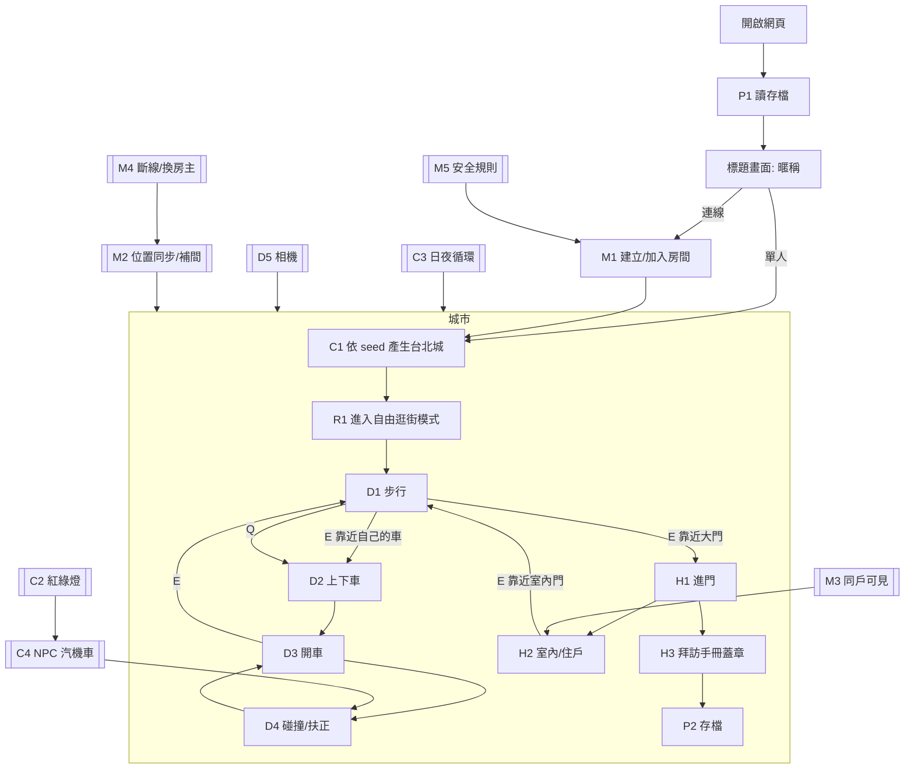

# 01 · Flow 與節點（Phase 1）

開發照節點推進：一個節點 = 一組可驗收的行為。節點完成的定義是「驗收條件全部有對應測試且通過」，不是「程式寫了」。

## 驗收怎麼算

- 每條驗收條件有編號（如 `D3-2`），測試名稱必須以 `[D3-2]` 開頭。
- `npm run flow:status` 跑全部測試，依編號回填 `docs/flow-status.md`：
  - ✅ 該節點所有條件都有測試且全過
  - 🟡 部分條件有測試且通過，其餘還沒有測試
  - ❌ 有任何一條測試失敗
  - ⬜ 一條都沒有測試
- 規則類用 Vitest 單元測試驗 `src/sim/`；連線與安全規則用 Firebase Emulator 測試；畫面類用 Playwright E2E；線上驗收（S 節點）只在設定 `LIVE_URL` 時跑。
- 節點前綴：C 城市、D 角色與車輛、H 住家、P 存檔、R 模式、M 連線、S 部署。

## 全局流程

## 節點表

| 節點 | 驗收條件 |
|---|---|
| C1 城市生成 | C1-1 同一個 seed 產生的地圖完全相同，不同 seed 的地圖不同；C1-2 道路網全部連通，從任一路段都能開到任一路段；C1-3 建築物、樹、長椅都不與道路重疊；C1-4 至少 20 戶可拜訪住家，門牌全城不重複且格式為「○○路 N 號 F 樓」；C1-5 每戶可拜訪住家的大門前 2 m 是可走的騎樓或人行道；C1-6 地圖含一座全城最高的地標塔與一段高架捷運；C1-7 東西向與南北向道路使用規則 §1-3 的路名 |
| C2 紅綠燈 | C2-1 任何時刻同一路口的兩個方向不會同時是綠燈或黃燈；C2-2 每個方向依序綠 8 秒、黃 2 秒、紅 10 秒循環 |
| C3 日夜循環 | C3-1 開局為 08:00，現實 10 分鐘走完一天；C3-2 19:00–06:00 判定為夜晚，夜晚路燈與窗戶亮起 |
| C4 NPC 交通 | C4-1 給定 seed 與時間，NPC 汽機車的位置與朝向完全確定；C4-2 NPC 遇紅燈或黃燈停在停止線前；C4-3 NPC 始終在車道內，不會進入建築物範圍；C4-4 同車道前後 NPC 間距始終至少 6 m；C4-5 NPC 有汽車也有機車 |
| D1 步行 | D1-1 WASD 依相機方向移動，步行 4 m/s、Shift 跑步 7 m/s；D1-2 步行不能穿過建築物與邊界牆 |
| D2 上下車 | D2-1 距自己的車 3 m 內按 E 上車，超過 3 m 不會上車；D2-2 下車後玩家位置不與任何物體重疊；D2-3 按 Q 車子出現在離玩家最近的路面上 |
| D3 開車 | D3-1 按住 W 加速，速度不超過 22 m/s；D3-2 按 S 先煞停再倒車，倒車不超過 6 m/s；D3-3 靜止時按 A/D 車頭方向不變，行進時會轉向；D3-4 Space 手煞車使車子比放開油門減速更快 |
| D4 碰撞 | D4-1 撞建築物或邊界牆後車子被推回物體外，速度變為反向 30%；D4-2 撞 NPC 車時玩家的車反彈；D4-3 按 R 車子移到最近的路面且朝向與道路平行 |
| D5 相機與畫面 | D5-1 按 C 在追蹤與俯瞰視角間切換；D5-2 真瀏覽器中按住 W 後自己的車在城市中前進（E2E）；D5-3 按 H 播放喇叭聲 |
| H1 進門 | H1-1 步行到可拜訪住家大門 2 m 內顯示含門牌的提示，超過 2 m 不顯示；H1-2 按 E 進入該戶室內；H1-3 開車時靠近大門不會出現提示也不能進門 |
| H2 室內 | H2-1 同一戶每次產生的室內格局相同，不同戶的格局可以不同；H2-2 靠近住戶 3 m 內顯示住戶打招呼與名字；H2-3 在室內大門按 E 回到戶外，位置在該戶大門外 |
| H3 拜訪手冊 | H3-1 第一次拜訪某戶時蓋章，重複拜訪不重複計算；H3-2 手冊顯示「已拜訪 x / 全部」與門牌清單（E2E） |
| P1 讀存檔 | P1-1 存檔寫入後讀回內容相同；P1-2 存檔損毀或版本不符時改用新存檔並回報需要提示玩家；P1-3 重新整理頁面後暱稱與拜訪紀錄仍在（E2E） |
| P2 自動存檔 | P2-1 拜訪紀錄變動時立即存檔；P2-2 每 10 秒自動存一次，含累計里程 |
| R1 模式介面 | R1-1 自由逛街模式實作模式介面並在開局時啟用；R1-2 切換模式時前一個模式的場景物件與 HUD 全部移除 |
| V1 寫實貼圖 | V1-1 立面、騎樓店面、頂樓、路面、人行道、草地、地標塔、室內地板與牆面都使用 docs/art/brief.md 的貼圖，進城後全部載入成功（E2E）；V1-2 夜間亮窗遮罩的窗位與 brief「立面窗位」一致；V1-3 貼圖檔的檔名與尺寸符合 brief，總大小不超過 1 MB |
| M1 房間 | M1-1 建立房間取得 4 碼房號，建立者成為房主；M1-2 輸入房號加入同一座城（同 seed）；M1-3 房號不存在顯示錯誤；M1-4 房間已有 6 人時加入失敗並顯示房間已滿；M1-5 暱稱必須是 2–12 字 |
| M2 位置同步 | M2-1 一位玩家移動後，另一位玩家畫面上看到他的角色或車子與暱稱跟著移動（E2E，兩個 browser context）；M2-2 位置上傳每秒不超過 10 次；M2-3 其他玩家的位置在兩次更新之間平滑補間 |
| M3 同戶可見 | M3-1 在同一戶室內的玩家互相看得到；M3-2 戶外與室內的玩家互相看不到 |
| M4 離線 | M4-1 玩家關閉頁面後 10 秒內從其他人的畫面消失；M4-2 房主離開時房主交給最早加入的玩家 |
| M5 安全規則 | M5-1 未登入不能讀寫房間；M5-2 玩家只能寫自己的玩家資料；M5-3 不能改房間的 seed 與建立者 |
| S1 線上驗收 | S1-1 線上頁面的 commit meta 等於 main 的 SHA；S1-2 線上單人：開車前進、下車走到住家、進門、出門；S1-3 線上兩個瀏覽器加入同一房間並看到對方移動 |
